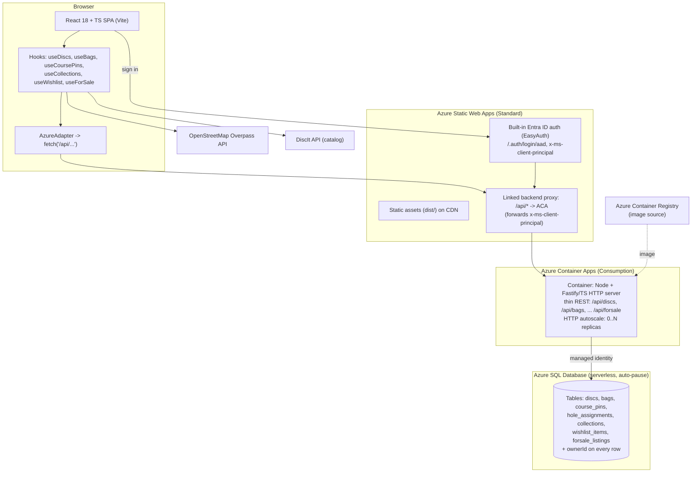
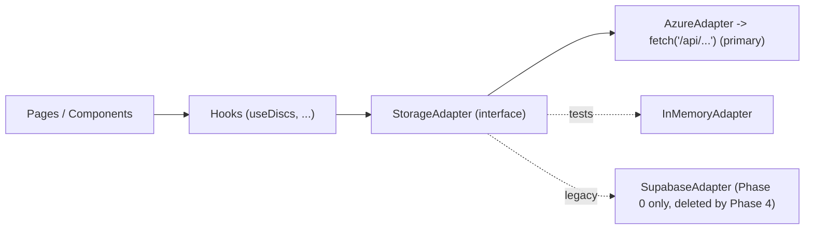

# ADR: Azure-hosted, Entra-authenticated, multi-user rebuild

**Author:** Danny (Lead / Architect)
**Date:** 2026-10-19 (revises the 2026-10-19 local-first plan)
**Status:** Proposed (planning + review only — no application code changed)
**Requested by:** Anders (AK)
**Supersedes:** `docs/adr-supabase-free-rebuild.md` (local-first / IndexedDB recommendation)
**Scope:** Re-target the `proispro` rebuild onto **Azure**, with **Microsoft Entra ID** auth and a **real hosted, shared database**, now that the app is **multi-user**. Bias unchanged: boring technology, minimal moving parts — just the minimum machinery a multi-user app actually requires.

> Architect's stance: every decision below is a named trade-off. Multi-user does **not** mean enterprise-complex. The whole game is to add exactly one tier — a shared database — and nothing more. One SPA, one thin API, one DB. The storage-adapter seam from the previous plan survives intact; only the adapter behind it changes.

---

## Revision — 2026-10-19 (compute/API tier only)

**What changed:** The **API tier moves off managed Azure Functions-in-SWA** and onto a **conventional long-running HTTP server packaged as a container on Azure Container Apps (ACA)** — primary — with **Azure App Service (Web App for Containers)** as the boring fallback. The **React SPA stays on Azure Static Web Apps**; the API is attached as a **SWA linked backend** so Entra EasyAuth keeps forwarding the authenticated principal with **near-zero auth code**.

**Why:** Anders gave two signals that touch only compute/API: (1) *"create an infrastructure where I can scale a bit more"* → he wants real horizontal headroom (replicas behind an HTTP autoscaler), which managed Functions-in-SWA does not expose cleanly; (2) *"Functions is hard to work with"* → the Functions programming model (triggers/bindings, stateless handlers, cold starts, awkward local dev) is a **developer-experience** tax. A standard Fastify/Express (or ASP.NET Minimal API) server is a normal web app you just **run locally**, with ordinary routing and middleware. **Developer experience is now a first-class requirement** and is weighted heavily.

**What did NOT change:** Entra ID auth, **Azure SQL Database serverless** (+ its documented fallback), the **storage-adapter seam** (`AzureAdapter` still just calls `/api/...` — only the server behind it changes), **per-owner `ownerId` scoping** replacing RLS, **friends as Entra B2B guests**, **`azd` + Bicep** IaC, the **phased seam→swap→delete** migration, **NO Supabase**, and **NO managed Data API Builder** (the §1.2 scar still binds). We do **not** jump to AKS or microservices — "scale a bit more" for a tens-of-users friends app is a replica count, not an orchestration platform.

> The sections below have been updated in place to reflect this. Where a section still reads "Functions," treat the Revision and §2 as authoritative.

---

## 0. TL;DR (the decision in four lines)

- **Hosting:** **Azure Static Web Apps (SWA)** serves the static React SPA + **built-in Entra ID auth** (EasyAuth). The **API is a separate tier** attached as a **SWA linked backend**, so EasyAuth still forwards the signed-in principal to it — no auth library in our code.
- **Compute/API:** A **conventional long-running HTTP server** (recommend **Node + Fastify/TypeScript**, or ASP.NET Minimal API) packaged as a **container on Azure Container Apps (ACA)**. Normal routing/middleware, **you just run it locally** — no triggers/bindings, no Functions programming model. HTTP autoscaling gives real horizontal headroom. **PRIMARY.**
- **Database:** **Azure SQL Database, serverless (auto-pause)** — relational, boring SQL, cheap-to-free at hobby scale, natural fit for per-owner rows and a shared for-sale view. **Unchanged.** ACA connects via **managed identity**.
- **API shape:** A **thin REST surface** (seven entities). The server derives `ownerId` from the Entra principal (forwarded `x-ms-client-principal`) and scopes every query — this replaces Supabase RLS. **Unchanged in contract; only the host changes.**
- **Keep the seam:** UI/hooks talk to a `StorageAdapter`; the new `AzureAdapter` still just does `fetch('/api/...')`. **Drop Supabase and the local-first (Dexie) direction.**
- **Fallback (compute):** **Azure App Service (Web App for Containers)** — the simplest "boring" PaaS with deploy slots + autoscale + always-warm. **Not AKS** (operational overhead unjustified at this scale).
- **Fallback (data):** **Cosmos DB serverless (free tier)** behind the same API if relational ops/cost disappoint; **Data API Builder** only **self-hosted** and only if hand-written CRUD becomes a burden (respect the scar in §1.2).

---

## 1. Updated Review & Requirement Delta

### 1.1 What changed, and why it invalidates the local-first recommendation

Earlier today I recommended going **local-first** (IndexedDB via Dexie, no backend, no auth), explicitly justified by a **single-user, one-or-two-device** assumption: "a spreadsheet that wants to be pretty." **That assumption is now void.** Anders will **share proispro with friends**, which makes the app **multi-user** and requires a **shared, persistent, hosted datastore** — exactly the one property IndexedDB structurally cannot provide (its data is per-browser/per-device). The moment two people must see a common set of for-sale listings, "the user's device is the database" stops being an honest answer. Local-first is therefore **withdrawn**: it optimised away the one tier the new requirement makes mandatory. Everything else from the prior review — the clean hook seam, pure `utils/disc.ts`, optimistic updates, the documentation drift — still holds and is reused below.

### 1.2 Reconciling the stale `decisions.md` entries (CosmosDB/DAB, Azure SWA)

The decisions log still shows several entries marked **Active** that must be read against later history:

- **"Primary Storage: CosmosDB via Data API Builder" — Active (Migrated)** and **"Hosting: Azure Static Web Apps + CDN" — Active (Migrated)** (both ~2026-04). These look prescient given today's Azure mandate — but they were **already superseded** by two later entries: **"DAB Retirement & Migration to Supabase"** and **"Azure Fully Decommissioned — Supabase is Sole Backend"**. The Azure/Cosmos/DAB stack was *actually tried and abandoned*, and the running system is Supabase + GitHub Pages. The "Active" label on the Cosmos/DAB/SWA entries is **stale** and must be corrected.
- **Were they prescient?** Partly. **SWA was the right hosting instinct** and is **revived** below. **Cosmos-as-primary and DAB are not revived as-is** — see the scar.
- **The scar that must shape this ADR:** the previous Azure attempt collapsed because **Azure SWA "Database Connections" (the *managed* Data API Builder integration) was retired on 2026-11-30 (announced/effective per our lessons-learned)**. The team "debugged a deprecated feature for days." The lesson (recorded in `docs/lessons-learned.md`): **check service deprecation first**, and **local tooling bundling its own runtime created an illusion of working code.** Consequence for this plan: **I will not depend on managed DAB-in-SWA.** DAB survives only as a *self-hosted* fallback (§2), which costs an extra runtime and therefore loses on "minimal moving parts" today.

**Reconciliation action (for the Scribe / Phase 6 docs):**
- Mark **CosmosDB-via-DAB (primary)**, **managed DAB**, and **Azure SWA + DAB** entries **Superseded** (they already were, de facto).
- Mark the **Supabase + GitHub Pages** entries **Superseded by this ADR** once we cut over.
- Add the new decisions: **Azure is the preferred cloud**, **Entra ID for auth**, **multi-user requirement**, **SWA (static SPA) + Azure SQL serverless + a container API on Azure Container Apps** (the revised compute tier — see the Revision note and §2).
- **Preserve the DAB-deprecation lesson prominently** — it is the reason the API tier is a **hand-written HTTP server we control**, not DAB.

### 1.3 What carries over from the prior review (unchanged, still true)

- **Clean data-access seam:** every feature is a `useX` hook returning `{ data, actions }`. The UI knows hooks, not transport. ~70% of the adapter refactor is already done.
- **Pure domain logic:** `utils/disc.ts` (filter/sort/group/stability) is persistence-agnostic and survives untouched.
- **Optimistic updates** already the norm — a hosted API with optimistic UI will feel the same.
- **Documentation drift is still the most dangerous problem:** `team.md` says Alpine.js; `decisions.md` shows contradictory "Active" Azure *and* Supabase realities. **No single document describes the running system.** This ADR + Phase 6 docs work closes it.
- **Orphaned infra still orphaned:** the Gemini `identify-disc` edge function and the dormant `disc-photos` Storage bucket have **zero callers in `src/`**. Retiring them remains cleanup, not feature loss.

### 1.4 Scale reality check (still modest — this keeps the design lean)

| Entity | Per-user realistic | Heavy user | × a handful of friends |
|---|---:|---:|---:|
| Discs | 20–80 | ~300 | low thousands total |
| Bags | 2–5 | ~10 | tens |
| Courses / pins | 3–15 | ~50 | low hundreds |
| Hole assignments | tens | low hundreds | ~1–2k |
| Wishlist | 5–30 | ~100 | hundreds |
| For-sale listings | 0–20 | ~50 | low hundreds (the shared surface) |

**Total, summed across friends: a few thousand rows, single-digit MB.** This is still not a "big data" problem. It is a **small shared relational dataset** — which is precisely what a serverless SQL database bills near-zero for and a thin API serves trivially. The multi-user requirement adds a tier; it does **not** add scale.

---

## 2. Target Azure Architecture (recommended, with named trade-offs)

### 2.1 The shape



One SPA on SWA's CDN, one **conventional HTTP API** as a single container on ACA (one runtime, autoscaled by request load), one DB. No AKS, no microservices, no message bus, no cache tier, no Dapr.

### 2.2 Compute / API host — **Azure Container Apps (PRIMARY), App Service (FALLBACK)**

The brief changed here: Anders wants to **scale a bit more** and finds **Functions hard to work with**. Both point away from managed Functions-in-SWA and toward a **normal web-API dev experience** — a standard long-running HTTP server (Fastify/Express or ASP.NET Minimal API) you run locally with ordinary routing/middleware, that scales **horizontally** behind an HTTP autoscaler.

| Option | Dev experience | Scaling model | Idle cost | Cold-start | Ops overhead | Entra / SQL integration | Verdict |
|---|---|---|---|---|---|---|---|
| **Azure Container Apps (ACA)** ✅ | **Excellent — it's just your container/server. `npm run dev` locally, ordinary routes & middleware, no triggers/bindings.** | **KEDA/HTTP autoscale on concurrent requests; `minReplicas 0..1`, `maxReplicas N`.** | **~$0 with scale-to-zero (generous Consumption free grant covers hobby use).** | Container spin-up (~seconds) on scale-from-zero; **eliminated by `minReplicas:1`** (small cost). | Low — managed container platform, no nodes/K8s to run. | **Managed identity → Azure SQL**; SWA linked backend forwards the Entra principal. | **PRIMARY — the sweet spot.** |
| **Azure App Service (Web App for Containers / code)** | Great — classic PaaS, push a container or code, **deploy slots**, easy logs. | Autoscale rules (CPU/memory/schedule); scale-out instances. **Always-warm** by default. | A small **always-on plan floor** (B1/P0v3) even when idle — no scale-to-zero on standard plans. | **None (always warm)** — but you pay for warmth. | Low — the "boring" PaaS. | Built-in **Easy Auth** option; managed identity → SQL. | **FALLBACK — boring and safe.** |
| Azure Kubernetes Service (AKS) | Powerful but heavy — clusters, nodes, upgrades, YAML. | Full HPA/cluster autoscale. | Node pool floor + ops time. | None (warm). | **High — you operate a cluster.** | Fine, but you wire everything. | **Rejected — operational overhead unjustified for tens of users.** |
| Managed Azure Functions in SWA *(previous choice)* | **The pain point:** triggers/bindings, stateless handlers, awkward local dev, cold starts. | Consumption auto-scale, but **little horizontal control** exposed in SWA. | ~$0. | Cold starts. | Built-in (same-origin). | **Replaced** — fails the new DX + "scale more" asks. |

**Decision: Azure Container Apps (Consumption).** It delivers a **conventional server dev experience** (run the container, standard HTTP routing — no Functions model), **explicit horizontal scale** (HTTP concurrency rule, `minReplicas`/`maxReplicas`), and **near-$0 idle** via scale-to-zero, while staying a **single managed runtime** (no cluster to operate). Keep **Dapr OFF** — we have one service and one DB; a service mesh/sidecar is complexity we don't need. *Trade-off named:* vs managed Functions we now **own a container image + a registry + a build step** (see §4) — a modest, well-understood cost we pay to get a normal dev loop and real scale knobs. *Why not App Service as primary:* it cannot scale to zero on standard plans, so it carries a constant idle floor; ACA wins on hobby-idle cost while still offering a warm option (`minReplicas:1`). **App Service remains the fallback** if we ever want the absolute simplest PaaS (slots, portal familiarity) and accept the always-on floor. **AKS is rejected** outright — a cluster is the wrong unit of complexity for a friends-group CRUD app.

### 2.3 Database — **Azure SQL Database, serverless (PRIMARY) — unchanged**

| Option | Cost at hobby scale | Simplicity | Entra/API fit | Named trade-off |
|---|---|---|---|---|
| **Azure SQL Database — serverless (auto-pause)** ✅ | **Auto-pauses to compute-$0 when idle; pay storage only (a few GB). Cheapest realistic "real DB" for bursty hobby use.** | Boring, familiar SQL; migrations easy; relational ownership + shared view are trivial `WHERE` clauses. | ACA connects with **managed identity** (preferred) or a connection string; clean server-side scoping. | **Cold-start on resume** (first query after idle waits a few seconds while compute resumes). Acceptable for a hobby app; warm-up/keep-alive optional. |
| Cosmos DB — serverless / free tier | Free tier (1000 RU/s + 25 GB) covers us; serverless bills per-request | NoSQL; fine for key-by-owner reads, but cross-owner shared queries and ad-hoc filters are clumsier | Good, but **this is where the prior team got burned via DAB** | Weaker for relational joins (collections↔discs, bag↔discs); partition-key design overhead. **Fallback, not primary.** |
| PostgreSQL Flexible Server | Burstable B1ms, **no true auto-pause** → a small but constant monthly floor | Boring SQL, great | Fine | **No auto-pause = always paying** even when idle; loses the cost game to SQL serverless for a bursty hobby app. |

**Decision: Azure SQL Database serverless — unchanged by the compute move.** Relational model matches the entities and the per-owner + shared-view access pattern exactly, and **auto-pause makes idle cost ~storage-only**. *Trade-off named:* cold-start latency after idle, traded for near-zero idle cost and SQL familiarity.

**Does a warm container change the SQL cold-start calculus?** Only slightly, and not enough to change the decision. SQL auto-pause is driven by **database inactivity**, not by whether the API is warm — an idle `minReplicas:1` container that holds a pool does **not** keep SQL awake, so the first query after a quiet period still pays the resume latency. If we run the API warm (`minReplicas:1`) and the cold-start ever annoys, the warm container is a convenient place to issue a lightweight **keep-alive `SELECT 1`** on a timer (Phase 7) — but defaulting to that trades idle cost for latency and is **not** recommended for v1. Net: SQL serverless stays primary; cold-start remains a named, accepted trade-off.

### 2.4 API layer — **thin conventional HTTP server (PRIMARY); self-hosted DAB fallback only**

| Option | Backend code volume | Named trade-off |
|---|---|---|
| **Thin Fastify/TS (or ASP.NET Minimal API) REST server on ACA** ✅ | Low–moderate: ~one small route group per entity (list/get/put/remove) sharing one query helper and one `ownerId` middleware. | We hand-write CRUD (but it is mechanical, testable, **ordinary web code**, and we **control** it). **No dependency on managed DAB** — the exact thing that was retired under us — and **no Functions programming model** — the thing Anders finds hard. |
| Data API Builder (DAB) auto-REST/GraphQL | Near-zero: config-generated endpoints | **The scar (§1.2):** managed DAB-in-SWA was *retired*. Reviving DAB means **self-hosting its runtime as a second container** — another image to build and scale. Only worth it if hand-written CRUD volume genuinely hurts; even then it rides the **same ACA environment**. |

**Decision: a thin, conventional HTTP server.** For seven small entities this is a modest, legible amount of **normal** web code (routes + a shared data-access helper), and it keeps us off both the deprecated DAB dependency **and** the Functions model. *Framework pick:* **Node + Fastify + TypeScript** as the recommended default — same language as the SPA (one toolchain, shared types), fast, first-class middleware, trivial local run (`node`/`tsx`), and a tiny Dockerfile. **ASP.NET Minimal API** is an equally valid pick if the team prefers C#/stronger typing against SQL — the ADR does not block it; both are "just an HTTP server in a container." *Trade-off named:* we write CRUD by hand (more code than DAB's zero) to **own our fate** and keep the runtime count at one.

### 2.5 Auth — **Entra ID via SWA EasyAuth, forwarded to the ACA API as a linked backend**

**Decision: keep SWA's built-in Entra ID (Azure AD) auth and attach the ACA API as a SWA _linked backend_ — not hand-rolled MSAL, if we can avoid it.**

Moving the API to a separate tier raises the question the brief calls out: *if the SPA leaves same-origin SWA Functions, how does Entra auth work now, with the least auth code?* Three paths, simplest first:

1. **SWA linked backend (PRIMARY, lowest auth code).** SWA (Standard tier) supports **linking a backend** — including an **Azure Container Apps** or App Service API. SWA continues to own sign-in (`/.auth/login/aad`), and when it **proxies `/api/*` to the linked ACA backend it forwards the authenticated principal in the `x-ms-client-principal` header** — exactly as it did for in-SWA Functions. **Result: our server reads the same header, derives `ownerId`, and scopes queries — with _no_ MSAL, no token handling, and the `AzureAdapter` still calling same-origin `/api/...`.** The seam and the zero-auth-code property **both survive** the tier split. *Trade-off / caveat:* linked backends require the **SWA Standard tier** and a **supported region**, allow **one linked backend per SWA**, and the API must trust the `x-ms-client-principal` header **only** because the SWA proxy is the sole ingress — so ACA ingress must be configured so the API is **not** independently reachable from the public internet bypassing SWA (restrict ingress / require the proxy). We name that as the one piece of new plumbing.
2. **MSAL-in-SPA + validate-JWT middleware (FALLBACK, if linked-backend constraints bite).** If the single-linked-backend limit, region, or ingress restriction is a problem, the SPA uses **MSAL** to acquire an access token for the **API's own Entra app registration**, and the ACA server runs a **small validate-JWT middleware** (validate issuer/audience/signature, read `oid` → `ownerId`). This is a **CORS + bearer-token** design across two origins (SWA + ACA). *Trade-off named vs the previous SWA-EasyAuth zero-code approach:* we now write **a little auth code** (MSAL config in the SPA + ~a dozen lines of JWT validation in the server) and manage **two app registrations + CORS** — more moving parts than EasyAuth's zero, but it is the standard, well-trodden SPA→API pattern and keeps the API independently reachable.
3. **App Service Easy Auth (only if we pick the App Service fallback host).** If compute falls back to App Service, its **built-in Easy Auth** can validate Entra tokens at the platform edge, injecting principal headers — a middle ground. Not applicable to ACA.

**Recommendation: path 1 (SWA linked backend).** It is the **simplest path that keeps "no/low auth code" while the API lives in a separate tier**, and it preserves the exact `x-ms-client-principal` contract the server design already assumes. Path 2 is the documented, pre-agreed escape hatch. *Trade-off named vs the old same-origin EasyAuth:* we accept SWA-Standard + the one-linked-backend limit + an ingress-lockdown step, in exchange for keeping auth code at **zero** despite splitting the API out.

**Per-user data isolation (unchanged) replaces Supabase RLS:** the server reads the authenticated principal (`x-ms-client-principal` under path 1, validated JWT `oid` under path 2) **server-side**, and scopes **every** query to `WHERE ownerId = @oid`. Writes stamp `ownerId` from the principal, never from the client body. **The client is never trusted for ownership** — enforced in one shared middleware/helper, not in 11 RLS policy files.

**Inviting friends — unchanged.**
- **Primary: Entra External Identities (B2B guests).** Anders invites each friend's existing Microsoft/work/Google-federated account as a **guest** in his tenant; they appear as principals with an `oid`, and the app authorizes any signed-in principal.
- *Alternative (documented, not chosen):* multi-tenant / consumer sign-in — more reach, more config, **overkill for a friends list.** Rejected for v1.
- **Authorization is coarse on purpose:** "any authenticated principal is a valid user; you can only see/edit your own rows, plus the shared for-sale surface." **No roles, no RBAC, no admin tier.**

### 2.6 Migration from GitHub Pages → SWA (+ ACA linked backend)

- **Hosting move:** stand up SWA (**Standard tier**, required for linked backends), point its build at the existing Vite `dist/`, deploy via the **SWA GitHub Actions workflow** (replaces the current Pages `deploy.yml`). Push-to-main stays the deploy trigger.
- **Link the API:** provision the **ACA environment + the API container app**, then **link it to SWA as the backend** so `/api/*` proxies to ACA and the Entra principal is forwarded. **Lock ACA ingress** so the API is reached through the SWA proxy, not independently from the public internet (see §2.5 caveat). *(If we fall back to App Service, link that instead.)*
- **Custom domain / CNAME:** repoint `proispro.com` from the **GitHub Pages** target to the **SWA default hostname** (`CNAME` to `<app>.azurestaticapps.net`, or SWA's apex/ALIAS guidance for the bare domain). **SWA manages the TLS certificate** automatically, as Pages did. *Trade-off:* a brief DNS cutover window; stage it with the SWA preview hostname first, validate, then flip the `CNAME`.
- **Routing:** add `staticwebapp.config.json` for SPA fallback (`/*` → `/index.html`), the Entra auth routes, and the `authenticated`-only rule on `/api/*` (the proxied backend routes).

### 2.7 Decision summary table

| Criterion (hobby scale, multi-user) | **PRIMARY: SWA (SPA) + ACA container API + Azure SQL serverless + Entra (EasyAuth linked-backend)** | FALLBACK (compute): App Service for Containers | FALLBACK (data): Cosmos serverless (+ self-hosted DAB) |
|---|:--:|:--:|:--:|
| Dev experience (DX) | ✅ **ordinary HTTP server, run locally, no triggers/bindings** | ✅ classic PaaS, push container/code | ⚠️ NoSQL modeling; DAB config |
| Horizontal scale | ✅ HTTP autoscale, `minReplicas..maxReplicas` | ✅ scale-out instances (CPU/schedule) | n/a (data tier) |
| Monthly cost at idle | ✅ ~$0 (ACA scale-to-zero + SQL auto-pause) | ⚠️ small always-on plan floor | ✅ free-tier RU/s; ⚠️ +container if DAB self-hosted |
| Cold-start | ⚠️ ACA from-zero spin-up (removable via `minReplicas:1`) + SQL resume | ✅ always warm | ✅ Cosmos always-warm |
| Ops overhead | ✅ one managed container runtime (no cluster) | ✅ one PaaS app | ⚠️ DAB adds a runtime |
| Entra fit | ✅ EasyAuth forwards principal; **zero auth code** | ✅ Easy Auth built-in | ✅ auth at SWA; ⚠️ DAB auth wiring |
| SQL fit | ✅ managed identity → SQL; relational ownership trivial | ✅ same | ⚠️ cross-owner reads clumsier |
| Backend code volume | ⚠️ hand-written thin CRUD (ordinary web code) | ⚠️ same | ✅ DAB ~zero *(but see scar)* |
| Fits "boring tech, scale a bit more" | ✅ | ✅ | ⚠️ |

**PRIMARY:** **SWA (static SPA) + Azure Container Apps (thin Fastify/TS HTTP API) + Azure SQL Database (serverless) + Entra ID (EasyAuth via SWA linked backend).**
**FALLBACK (compute):** **Azure App Service (Web App for Containers)** — same container, always-warm PaaS, at the cost of an idle floor.
**FALLBACK (data):** **Cosmos DB serverless** behind the same API (swap the data layer, not the seam); **self-hosted DAB** only if CRUD volume hurts.

### 2.8 Scaling story — "a bit more," honestly

Anders asked for room to **scale a bit more**. Concretely, on ACA:

- **Autoscale rule:** scale on **HTTP concurrency** — e.g. ~**50–100 concurrent requests per replica** (KEDA HTTP scaler). CPU/memory rules are available too, but concurrency is the right signal for a thin CRUD API.
- **Replica range:** **`minReplicas: 0` or `1`**, **`maxReplicas: 3`** (a sane ceiling for this app). Each new replica is another identical stateless container the platform spins up and load-balances automatically — **that is the "more horizontal headroom" Anders wanted**, and it's a number in Bicep, not an architecture change.
- **Scale-to-zero vs min-1-warm — the cost/latency trade-off:**
  - **`minReplicas: 0` (recommended default):** **~$0 when nobody's using it** (idle replicas cost nothing on Consumption; the free grant likely covers all real usage). Cost of this choice: a **few-seconds cold start** on the first request after idle (container spin-up **plus** SQL resume). Honest and fine for a friends app.
  - **`minReplicas: 1`:** **no API cold start** (one replica always warm) at the cost of a **small constant charge** for that always-on replica. Choose this only if the cold first-load becomes an actual annoyance. Note it does **not** keep Azure SQL awake (§2.3).
- **Statelessness is the enabler:** because the server holds **no session state** (identity comes from the forwarded principal per request; all state is in SQL), replicas are interchangeable and scaling out is safe — no sticky sessions, no in-memory caches to coordinate.
- **Realistic ceiling — kept honest:** this is **tens of users**, not thousands. The §1.4 data is a few thousand rows / single-digit MB, and friend traffic is bursty and low-concurrency. In practice **1–2 replicas** will serve the entire friend group with headroom; `maxReplicas: 3` exists for a surprise spike, not because we expect one. **"Scale a bit more" = a replica count we can raise, not a platform we must operate.** If this app ever genuinely needed thousands of concurrent users, *that* would be a new ADR — not today's problem.

---

## 3. Simple Design & Patterns

### 3.1 Keep the storage-adapter seam (now backed by `AzureAdapter`)

The seam is still the whole trick: the UI and hooks import an **interface**; only the adapter knows the transport. Supabase was "one adapter"; **Azure's REST API is now the adapter.** Components stay persistence-ignorant (they already are).



```ts
// The seam — unchanged interface, new implementation behind it.
export interface StorageAdapter {
  discs: Collection<Disc>
  bags: Collection<Bag>
  coursePins: Collection<CoursePin>
  holeAssignments: Collection<HoleAssignment>
  collections: Collection<Collection_>
  wishlist: Collection<WishlistItem>
  forSale: ForSaleCollection          // adds a shared-read; see 3.3
  exportAll(): Promise<Backup>        // JSON backup / portability
  importAll(data: Backup): Promise<void>
}

export interface Collection<T> {
  list(): Promise<T[]>                 // server scopes to ownerId
  get(id: string): Promise<T | undefined>
  put(item: T): Promise<T>             // insert or update; server stamps ownerId
  remove(id: string): Promise<void>
}

export interface ForSaleCollection extends Collection<ForSaleListing> {
  listShared(): Promise<ForSaleListing[]>   // listings from ALL owners where visibility = 'shared'
}
```

- **No Redux/Zustand/RTK Query.** Hooks + local state + optimistic updates already carry this app. *Trade-off:* cross-hook coordination stays explicit (it already is).
- **`AzureAdapter` is a dumb transport:** `fetch('/api/discs')` etc.; **the compute move is invisible here** — the adapter still calls same-origin `/api/...`, SWA proxies it to the ACA container, and the session cookie/principal rides automatically. **Only the server behind `/api/*` changed (ACA container instead of in-SWA Functions); the seam, the interface, and the client code are unchanged.** *(Under the path-2 auth fallback, the adapter attaches an MSAL bearer token instead of relying on the cookie — a one-line change isolated to the adapter.)* **No ownership logic in the client.**
- **`utils/disc.ts` stays exactly as-is.**

### 3.2 Core data model (plain TS, now with ownership)

```ts
type DiscType = 'putter' | 'midrange' | 'fairway' | 'distance'
type Condition = 'new' | 'good' | 'used' | 'beat'

type OwnerId = string          // Entra object id (oid) of the owning user

interface Owned { ownerId: OwnerId }   // stamped server-side from the principal; never trusted from client

interface Disc extends Owned {
  id: string
  name: string; manufacturer: string; type: DiscType | ''
  plastic: string; weight: string; color: string; condition: Condition
  speed: number | ''; glide: number | ''; turn: number | ''; fade: number | ''
  notes: string; tags: string[]
  photoUrl: string | null     // optional; see 3.4 (no bucket for v1)
  added: number; quantity: number
}

interface Bag extends Owned { id: string; name: string; discIds: string[] }

interface CoursePin extends Owned { id: string; courseName: string; courseId: string | null; bagId: string; createdAt: number }
interface HoleAssignment extends Owned { id: string; coursePinId: string; holeRef: string; discId: string; discName: string }

interface Collection_ extends Owned { id: string; name: string; description: string; discIds: string[] }

interface WishlistItem extends Owned {
  id: string; discName: string; manufacturer: string; plasticPref: string
  weightMin: number | null; weightMax: number | null
  priority: number; notes: string; acquired: boolean; createdAt: number
}

interface ForSaleListing extends Owned {
  id: string; discId: string
  snapshot: Pick<Disc,'name'|'manufacturer'|'type'|'plastic'|'color'|'weight'|'condition'>
  status: 'available' | 'sold'
  visibility: 'private' | 'shared'    // 'shared' = visible to all signed-in friends
  sellerName: string                  // display handle shown to friends (from Entra displayName)
  askingPrice: number | null
  listedAt: number
}

interface Backup {
  version: 2; exportedAt: number; ownerId: OwnerId
  discs: Disc[]; bags: Bag[]; coursePins: CoursePin[]; holeAssignments: HoleAssignment[]
  collections: Collection_[]; wishlist: WishlistItem[]; forSale: ForSaleListing[]
}
```

### 3.3 Multi-tenancy pattern — per-owner rows + one shared surface

- **Default is private.** Every table has `ownerId`. Every list/get/put/remove is scoped to the caller's `oid` in a single shared server helper. This **is** the isolation model (the lean replacement for RLS): *the server, holding the Entra principal, is the only thing that decides ownership.*
- **The one shared thing is for-sale.** A listing with `visibility: 'shared'` is readable by **any** authenticated friend via `forSale.listShared()` → `GET /api/forsale/shared`, which returns `WHERE visibility = 'shared' AND status = 'available'` **across all owners** (read-only for non-owners; only the owner can edit/delete their own). This replaces the old `sale.html?token=...` public link with an **authenticated, friends-only marketplace view** — simpler and no anonymous token surface.
- **No RBAC, no admin, no org model.** Two authorization states only: *authenticated* (you are a user) and *owner-of-this-row* (you can mutate it). Everything else is a `WHERE` clause.
- **Boring on purpose:** no microservices, no event sourcing, no CQRS, no background workers. One SPA + one thin API + one DB.

### 3.4 Photos (kept trivial for v1)

The Supabase `disc-photos` bucket is dormant (no upload call in `src/`). For v1, **`photoUrl` is an optional string only** — no Azure Blob Storage container, no upload tier. *Trade-off:* no first-class photo upload yet. If/when wanted, add **one Azure Blob container** with per-owner virtual folders and SAS-on-write from an API route — a small, isolated Phase-7 addition behind the same adapter. Keep it out of the critical path.

---

## 4. Migration / Rebuild Plan (phased, incremental — never run without a working app)

> Strategy unchanged in spirit: **seam first, swap second, delete last.** The seam already exists conceptually; we are changing the implementation behind it and adding one real tier. *Compute-tier revision:* the API tier is now a **container on ACA** (built + pushed in CI), not in-SWA Functions — so Phases 1–3 pick up a **Dockerfile, an Azure Container Registry (ACR), and an image build/deploy step**.

**Phase 0 — Storage-adapter seam (unchanged value).**
Define `StorageAdapter` + `Collection<T>` + `ForSaleCollection`. Wrap the *current* Supabase calls as a `SupabaseAdapter` implementing it; re-point hooks at the adapter. App behaves identically. *Keystone — everything after is a swap.* De-risk: pure refactor, covered by the Playwright suite.

**Phase 1 — Provision Azure (IaC).**
Stand up the resource group via **`azd` (Azure Developer CLI) with Bicep** (recommend `azd` for one-command `up`/`down` + repeatable envs; Bicep modules under the hood). Resources: **SWA (Standard)**, an **Azure Container Apps environment + the API container app** (HTTP ingress, `minReplicas`/`maxReplicas`, system-assigned **managed identity**), an **Azure Container Registry (ACR)** for the image, **Azure SQL Database (serverless, auto-pause)** with the managed identity granted DB access, and the **Entra app registration(s)** (one for SWA's AAD provider; a second API app registration only if the §2.5 path-2 auth fallback is used). **Link the ACA app to SWA as the backend** and restrict ACA ingress to the proxy path. Keep it one environment + one optional `preview`. *Owner: Linus.* De-risk: `azd up` into a throwaway env first; commit the Bicep; no portal click-ops.

**Phase 2 — Schema + thin container API.**
Create the SQL schema (seven tables + `ownerId` + indexes on `(ownerId)` and `forsale(visibility,status)`). Implement the **thin HTTP server** (recommend **Node + Fastify + TypeScript**): one route group per entity sharing an `ownerId`-scoping helper/middleware that reads the forwarded `x-ms-client-principal` (or validated JWT under path-2), plus `/api/forsale/shared`. Add a **small, standard `Dockerfile`** (e.g. `node:lts-alpine`, `npm ci`, build, run) and a local `docker compose`/`npm run dev` loop. *Owners: Danny (schema + API contract + auth-validation design), with the server implementation.* De-risk: contract tests against an `InMemoryAdapter`; integration test the ownership helper (A cannot read B's rows); run the container locally before any deploy.

**Phase 3 — `AzureAdapter` + wire Entra auth in React + CI image pipeline.**
Implement `AzureAdapter` (plain `fetch` to `/api/*`). Under the **primary** auth path (SWA linked backend) the session principal rides the proxy — add sign-in/out via `/.auth/login/aad` + `/.auth/me`, gate the app on an authenticated principal, **no MSAL**. *(If the path-2 fallback is chosen, add MSAL token acquisition in the adapter and CORS.)* Stand up the **CI step that builds the container image, pushes to ACR, and deploys the new revision to ACA** (and the SWA Actions workflow for the SPA). Add `VITE_STORAGE=azure|supabase` toggle to run old/new side-by-side. *Owners: Rusty (adapter + MSAL/sign-in wiring if SPA auth changes), Livingston (sign-in + sharing UX), Linus (CI container pipeline).* De-risk: run the e2e suite under `VITE_STORAGE=azure` against a dev SWA + dev ACA revision.

**Phase 4 — Data migration (Supabase → Azure SQL) + cutover.**
Ship the Phase-0 **Export** in the live Supabase build (pulls every table → `Backup` JSON). Build a small **import/migration tool** that maps the backup into Azure SQL, **stamping `ownerId`** from the signing-in user (Anders migrates his own data first; friends start empty or import their own). Flip SWA to default, **cut hosting GitHub Pages → SWA** (repoint `CNAME`, validate on the preview hostname + a staged ACA revision first). *Owners: Basher (Supabase→Azure export/migration tooling), Linus (SWA deploy + ACA revision + DNS).* De-risk: round-trip test (export → import → row-count + spot-check); keep the Pages deploy reachable until DNS + SWA + ACA are verified, then retire it.

**Phase 5 — Delete Supabase + legacy.**
Remove `src/lib/supabase.ts`, the auth workarounds, `@supabase/supabase-js`, and the `supabase/` dir (migrations + edge fn); archive the SQL in `docs/archive/`. Retire the legacy Alpine files (`app.js`, `disc-catalog.js`, `flight-guide.*`, `legacy-index.html`, `styles.css`) and resolve `sale.html` → replaced by the authenticated shared-for-sale view. *Owners: Rusty + Linus.* De-risk: grep gate — zero `supabase` imports, zero legacy references; CI build passes with the dependency removed; SWA workflow ships only `dist/`, ACA pipeline ships only the API image.

**Phase 6 — Reconcile documentation & governance (close the drift).**
Rewrite `team.md` Tech Stack → **React 18 + TS + Vite + Azure SWA (SPA) + Azure Container Apps (Fastify/TS API) + Azure Container Registry + Azure SQL serverless + Entra ID**, **multi-user**. Supersede the stale `decisions.md` entries (Alpine stack, Cosmos/DAB-Active, SWA+DAB, *and* the Supabase entries). Add the new decisions (this ADR + the compute-tier revision). Keep the **DAB-deprecation lesson** visible. *Owners: Danny + Scribe.*

**Phase 7 (optional, deferred) — Photos / BYO-key disc-ID / warm-keepalive.**
One Blob container for photo upload; optional BYO-key Gemini disc-ID (user's own key, browser-direct); optional SQL keep-warm ping if cold-start annoys. All additive behind the seam.

### 4.1 Data migration path (Supabase → Azure SQL), concretely

1. Live Supabase build → **Export** → `proispro-backup.json` (reuses existing `fromDb*` mapping).
2. Migration tool (Basher) → authenticate to SWA as the target owner → **Import** → `INSERT ... ownerId = <caller oid>` into Azure SQL via the **container API** (same `/api/*` endpoints) or a one-shot script using managed identity.
3. Photos: dormant today → likely a no-op; if any exist, carry `photoUrl` strings as-is (no bucket in v1).
4. One-time, reversible (the JSON is the user's own copy); no live dual-write needed because the seam toggle lets us validate before flipping DNS.

### 4.2 Infra-as-code note

**Recommend `azd` (Azure Developer CLI) + Bicep.** `azd` gives `up`/`down`/`env` ergonomics and wires **SWA + ACA environment + the API container app + ACR + SQL + the Entra app registration(s)** reproducibly; Bicep modules keep it declarative and reviewable. `azd` also understands the **build-and-push-container** step, so `azd up` can build the image, push to ACR, and deploy the ACA revision in one command. *Trade-off:* a small learning curve vs. portal click-ops — paid back the first time we rebuild an environment or onboard a reviewer. **No Terraform** — one IaC tool, and `azd` is the native, lowest-friction choice here. **No AKS/Helm** — ACA needs no cluster manifests.

### 4.3 Risks and de-risking

| Risk | Likelihood | Impact | De-risk |
|---|---|---|---|
| **Repeating the DAB scar** (depending on a deprecated managed feature) | Low | High | **Avoid managed DAB entirely**; a conventional HTTP server we control. Check deprecation notices first (lessons-learned rule). |
| **Cross-origin CORS/auth** between SWA (SPA) and ACA (API) | Med | Med | **Prefer the SWA linked-backend path** (same-origin `/api/*`, principal forwarded → no CORS). Only the path-2 fallback introduces CORS; if used, pin `Access-Control-Allow-Origin` to the SWA host + validate JWT audience/issuer. |
| **API reachable bypassing the SWA proxy** (header-trust risk) | Med | High | Lock ACA ingress so the API is only reached via the SWA linked backend; **never trust `x-ms-client-principal` on an independently-public endpoint.** Under path-2, validate the JWT instead of trusting a header. |
| **CI image build/push** flaky or slow | Med | Low | Standard `Dockerfile`; cache `npm ci`; build on push to main; keep the previous ACA revision for instant rollback. |
| **Warm-vs-cold cost** mis-set (paying for idle, or slow first load) | Med | Low | Default `minReplicas:0` (cost ~$0, accept cold start); flip to `minReplicas:1` only if the first-load latency is an actual complaint — a one-line Bicep change. |
| SQL serverless **cold-start** annoys users | Med | Low | Accept for hobby; optional keep-warm ping (Phase 7); communicate the "first load after idle is slow" behavior. |
| **Ownership bug leaks** one user's rows to another | Low | High | Single shared server-side scoping helper/middleware; integration test "A cannot read/write B"; never read `ownerId` from the client body. |
| **DNS cutover** downtime (Pages → SWA) | Med | Med | Validate on SWA preview hostname + staged ACA revision first; low-TTL `CNAME`; flip during a quiet window; keep Pages live until verified. |
| Friend onboarding friction (Entra guest invites) | Med | Low | Document the B2B-guest invite steps; a handful of people, done once. |
| Cost surprise | Low | Med | ACA scale-to-zero + Consumption free grant + SQL serverless auto-pause + SWA tier; set a budget alert; review after first month of real friend usage. |
| Loss of anonymous public share link (`sale.html?token`) | High | Low | **Intentional** — replaced by an authenticated friends-only shared view (simpler, no token surface). Confirm with Anders. |

### 4.4 Follow-up work items (mapped to squad members)

| # | Title | Owner | Capability flag |
|---|---|---|---|
| 1 | `StorageAdapter`/`Collection<T>`/`ForSaleCollection` seam + wrap Supabase as adapter (Phase 0) | **Rusty** | 🟢 |
| 2 | Provision Azure via `azd`+Bicep: SWA + **ACA env + API container app + ACR** + Azure SQL serverless + **Entra app reg(s)**; **SWA + CI container (build→ACR→ACA) pipelines** (Phases 1,3-CI,4-deploy) | **Linus** | 🟡 (infra/CI — review) |
| 3 | SQL schema + **thin Fastify/TS API shape** + `ownerId` scoping middleware + **auth-validation design** (linked-backend header / JWT fallback) + `/api/forsale/shared` (Phase 2) | **Danny** → implementation | 🟡 |
| 4 | `AzureAdapter` + Entra sign-in wiring (**MSAL only if SPA auth changes to path-2**) + `VITE_STORAGE` toggle (Phase 3) | **Rusty** | 🟢 |
| 5 | Sign-in + friends-only sharing/for-sale UX (Phase 3) | **Livingston** | 🟡 |
| 6 | Supabase→Azure SQL export/import migration tooling + round-trip test (Phase 4) | **Basher** | 🟡 |
| 7 | Delete `@supabase/*` + `supabase/`; retire legacy Alpine files; resolve `sale.html` (Phase 5) | **Rusty** + **Linus** | 🟡 |
| 8 | Reconcile `team.md` + supersede stale `decisions.md` entries; keep DAB lesson visible (Phase 6) | **Danny** + **Scribe** | 🟢 |
| 9 | (Deferred) Blob photo upload / BYO-key disc-ID / SQL keep-warm (Phase 7) | **Danny** → **Rusty**/**Linus** | 🔴 until wanted |

---

## 5. ADR Summary

### ADR: Rebuild proispro as a multi-user Azure app on Static Web Apps (SPA) + Container Apps (API) + Azure SQL + Entra ID

**Status:** Proposed — 2026-10-19 — Danny (Lead / Architect). Supersedes the local-first ADR. **Revised same day:** API tier moved from managed Functions-in-SWA to a container API on ACA (see the Revision note at the top).

**Context.**
The single-user assumption that justified a local-first (IndexedDB/Dexie, no-auth) rebuild is **void**: Anders will share proispro with friends, making it **multi-user** and requiring a **shared, hosted, persistent database** — which per-device IndexedDB cannot provide. Azure is the preferred cloud (full Entra ID environment available). Constraints hold: **no Supabase**, boring technology, minimal moving parts. A prior Azure attempt (Cosmos + **managed Data API Builder** in SWA) was abandoned when **SWA Database Connections / managed DAB was retired (2026-11-30)**; the lesson — check deprecation first, don't trust runtime-bundling illusions — constrains this design. **Two later signals refined compute only:** Anders wants to *"scale a bit more"* (real horizontal headroom) and finds *"Functions hard to work with"* (DX pain). `decisions.md` still carries stale "Active" Azure *and* contradictory Supabase entries; `team.md` wrongly says Alpine.js.

**Decision.**
Rebuild with the **React SPA on Azure Static Web Apps** (static CDN + **built-in Entra ID auth**) and the **API as a conventional long-running HTTP server (recommend Node + Fastify + TypeScript) packaged as a container on Azure Container Apps (ACA)**, backed by **Azure SQL Database (serverless, auto-pause)** via **managed identity**. The ACA API is **attached to SWA as a linked backend**, so EasyAuth forwards the Entra principal (`x-ms-client-principal`) with **near-zero auth code**; if the linked-backend constraints bite, the documented fallback is **MSAL-in-SPA + a small validate-JWT middleware** across two origins. The API is a **thin hand-written REST surface** (seven entities) that derives `ownerId` from the principal server-side and scopes every query — replacing Supabase RLS with one shared middleware. The **storage-adapter seam is preserved**; a new **`AzureAdapter`** still just calls `/api/...` — only the server behind it changed. Multi-tenancy = per-owner rows + one `visibility:'shared'` for-sale surface; **no RBAC**. Horizontal scale = ACA HTTP autoscale (`minReplicas 0..1`, `maxReplicas 3`). Provision with **`azd` + Bicep** (SWA + ACA env + API app + **ACR** + SQL + Entra app reg); **CI builds/pushes the container image to ACR and deploys the ACA revision.** Migrate data via **JSON export → import (stamping `ownerId`)**, then cut hosting GitHub Pages → SWA and delete Supabase + legacy Alpine files. Execute incrementally (seam → swap → delete); never run without a working app. **Not AKS** (operational overhead unjustified); **App Service for Containers** is the boring compute fallback.

**Consequences.**
- **Positive:** Real shared multi-user data; **a normal web-API dev experience** (run the container locally, ordinary routing/middleware — no triggers/bindings, no Functions model); **real horizontal scale** (replica count in Bicep); Entra auth with **near-zero auth code** (EasyAuth linked backend); near-$0 idle cost (ACA scale-to-zero + SQL auto-pause); one SPA, **one container runtime**, one DB; isolation enforced in one place; ends documentation drift; **no dependency on the retired managed-DAB feature.**
- **Negative / costs named:** We now **own a container image + ACR + a CI build step** (vs managed Functions' zero build); we **hand-write CRUD** (by choice, to own our fate); the API in a separate tier adds **linked-backend constraints** (SWA Standard, one backend, ingress lockdown) **or**, under the fallback, **CORS + a second app registration**; **ACA and SQL cold-start** on scale-from-zero/idle (removable by `minReplicas:1` + keep-warm, at a small cost); a **DNS cutover** window; friend onboarding needs **Entra guest invites**; **no public anonymous share link**; no photo upload in v1.
- **Reversible?** The seam keeps the data layer swappable (**Cosmos serverless**, or **self-hosted DAB in the same ACA env**) without a UI rewrite; the compute host is swappable too (**App Service for Containers** runs the identical image).

**Alternatives considered.**
- *Local-first (IndexedDB/Dexie)* — **withdrawn:** cannot provide shared multi-user data, the new hard requirement.
- *Managed Azure Functions in SWA (the previous API choice)* — **replaced:** fails the new DX ("Functions is hard to work with") and the "scale a bit more" ask (little horizontal control); container API gives both.
- *Azure App Service (Web App for Containers)* — **compute fallback:** simplest PaaS with slots + always-warm, but **no scale-to-zero** → a constant idle floor; ACA wins on hobby-idle cost.
- *AKS / microservices* — **rejected:** operating a cluster is the wrong unit of complexity for tens of users.
- *Cosmos DB serverless as primary* — **data fallback:** weaker for relational ownership + cross-owner shared reads; also the locus of the prior DAB scar.
- *PostgreSQL Flexible Server* — rejected: **no true auto-pause** → constant idle cost loses to SQL serverless at hobby scale.
- *Data API Builder (auto-REST)* — **fallback only:** minimizes code but the managed-in-SWA variant was retired; self-hosting it adds a second container, only worth it if CRUD volume hurts.
- *MSAL-in-SPA auth as primary* — **demoted to fallback:** more token code + CORS than the EasyAuth linked-backend path; kept as the documented escape hatch and for any future downstream Graph calls.
- *Multi-tenant / consumer Entra sign-up* — rejected for v1: overkill for a friends list; B2B guest invites are leaner.
- *Keep Supabase, fix docs only* — rejected: violates the explicit "no Supabase" + "Azure preferred" mandate.

---

*Prepared for Anders. Multi-user, still boring — now with a normal API you can actually run locally and a replica count you can raise. We add exactly one tier — a shared database — and move the API onto a conventional container; nothing more. The seam is still the whole trick: decouple persistence once, and Azure-SQL-now / Cosmos-maybe / DAB-perhaps — and ACA-now / App-Service-maybe — are all swaps, not rewrites. And we do not re-walk the DAB plank.*
