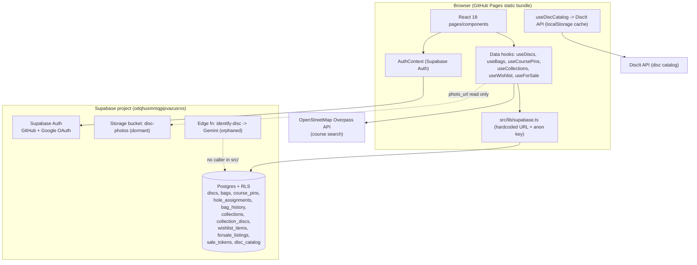
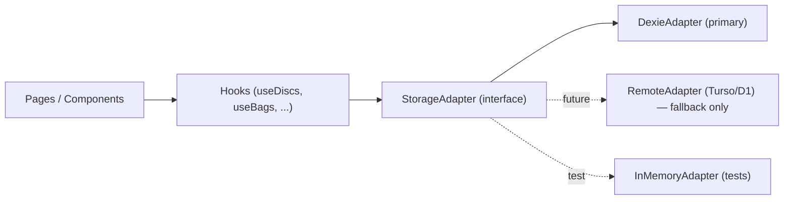

# Architecture Review & Supabase-Free Rebuild Plan

> **⚠️ SUPERSEDED (2026-10-19):** The single-user assumption behind this local-first plan is void — proispro is now **multi-user** (shared with friends) and targets **Azure + Entra ID**. See the current plan: **[`docs/adr-azure-entra-rebuild.md`](./adr-azure-entra-rebuild.md)**. The review content below is retained for provenance only.

**Author:** Danny (Lead / Architect)
**Date:** 2026-10-19
**Status:** Superseded by `docs/adr-azure-entra-rebuild.md` (planning + review only — no code changed)
**Requested by:** Anders (AK)
**Scope:** Full current-state review of `proispro` + a plan to rebuild on a lightweight, **Supabase-free** architecture. Bias: the simplest thing that works for a single-user, hobby-scale app on GitHub Pages.

> Architect's stance: every decision below is a named trade-off. If I can't name the cost, I haven't thought hard enough. The guiding principle here is **boring technology and minimal moving parts** — we are deliberately trading away server-side power we are not using for radical simplicity we will actually feel.

---

## 0. TL;DR (the decision in three lines)

- **Recommendation:** Go **local-first**. Persist to **IndexedDB via Dexie**, behind a single **storage-adapter (repository) seam** so the UI never imports the database. **Drop auth entirely.** Ship **JSON export/import** as the backup + migration + portability story.
- **Fallback (only if multi-device sync becomes a hard requirement):** Add **Turso (libSQL)** or **Cloudflare D1 + a tiny Worker** behind the *same* adapter interface. No UI rewrite.
- **The edge function and Supabase Storage are already effectively dead code** in the React app — retiring them is cleanup, not a feature loss.

---

## 1. Current-State Review

### 1.1 Architecture map



**Auth flow:** `LoginPage` → `signInWithOAuth({ provider })` (Google or GitHub) → OAuth redirect back to `window.location.origin` → `onAuthStateChange` sets the user → hooks gate every query on `user`. `src/lib/supabase.ts` carries two hand-rolled workarounds: a memory-backed `authStorage` (Edge Tracking Prevention blocks cross-site `localStorage`) and a serialized `authLock` (a `navigator.locks` race caused 15–25s login hangs). Both are smells of fighting the auth layer.

**Feature surface (from `App.tsx` + `pages/`):** a tab shell (note: `react-router-dom` is a dependency but routing is actually `useState<Tab>`) over seven features — Inventory, Bags, Courses (OSM-backed pins + per-hole disc assignments), Collections, Wishlist, For-Sale (with a public share token + `sale.html`), and Analytics (recharts).

### 1.2 What each Supabase dependency actually provides

| Dependency | Provides | Actually load-bearing? |
|---|---|---|
| **Postgres + RLS** | All CRUD for 11-ish tables, `user_id` scoping | **Yes** — the real backbone |
| **Auth (OAuth)** | Google/GitHub sign-in, `user.id` for RLS | **Yes**, but see §2 — it exists mainly to feed RLS, not because users need accounts |
| **Storage (`disc-photos`)** | Private per-user photo bucket (RLS by folder = uid) | **No** — `photo_url`/`user_photo_url` is *read* in `utils/disc.ts` and `DiscCard.tsx`, but there is **no upload call anywhere in `src/`**. Dormant. |
| **Edge fn `identify-disc`** | Gemini vision disc-ID from a photo | **No** — **zero callers** in `src/` (grep: no `functions.invoke`, no `identify` reference). Orphaned. |
| **`disc_catalog` table** | Canonical disc flight numbers | **Partially** — the live app autofills from the **DiscIt API** (`useDiscCatalog`), not Supabase. The catalog table + the flight-numbers ADR are a parallel, not-yet-wired track. |

### 1.3 Strengths

- **Clean data-access shape.** Every feature is a self-contained hook (`useX`) returning `{ data, actions }`. The UI already doesn't know SQL — it knows hooks. That seam is 70% of the refactor already done for us.
- **Good client-side domain logic.** `utils/disc.ts` (filter/sort/group/stability) is pure, framework-free, and persistence-agnostic. It survives any rebuild untouched.
- **Optimistic updates** are already the norm in `useBags`/`useDiscs` — local-first will *feel the same or faster*.
- **Lazy-loaded pages**, small bundle, static hosting. The deployment story is genuinely simple.

### 1.4 Genuine problems

1. **Secrets in the client.** `SUPABASE_URL` + anon key are hardcoded in `src/lib/supabase.ts`. That's *expected* for a Supabase anon key (RLS is the real guard), but it means security correctness rests entirely on RLS policies being perfect across 11 tables — a large, invisible attack surface for a hobby app.
2. **Severe documentation drift (three conflicting sources of truth):**
   - `team.md` → "Frontend: **Alpine.js** (CDN) + vanilla CSS" — **wrong**; the app is React 18 + TS + Vite 6.
   - `decisions.md` → "Primary Storage: **CosmosDB via Data API Builder**" and "Hosting: **Azure Static Web Apps**" marked **Active** — **wrong**; the code is **Supabase** and `deploy.yml` ships to **GitHub Pages**.
   - Reality (package.json + deploy.yml) → **React/Vite + Supabase + GitHub Pages**.
   This is the single most dangerous problem: **no document describes the system that is actually running.** Any agent trusting `.squad` state will build the wrong thing.
3. **Dual codebases.** Legacy vanilla/Alpine files (`index.html`, `app.js`, `disc-catalog.js`, `flight-guide.*`, `legacy-index.html`, `sale.html`, `styles.css`) live at repo root alongside the React app in `src/`. Two mental models, unclear which `index.html` wins, dead-code risk, and `sale.html` is *still* referenced as the live public-share target by `useForSale`.
4. **Single-user vs multi-user incoherence.** The schema, RLS, and `user_id` columns are built for **multi-tenancy**, but every ADR calls this a "single-user app." We are paying the full complexity cost of multi-user (auth, RLS, OAuth workarounds, per-row user scoping) for a benefit — multiple accounts — that the product explicitly does not want.
5. **Fighting the auth layer.** The two workarounds in `supabase.ts` (Edge storage shim, lock serialization) are ongoing maintenance tax caused solely by needing a hosted auth session in a static page.
6. **Orphaned infrastructure.** The edge function (a Gemini key, a Deno deploy target, a second runtime) and the Storage bucket are provisioned complexity with no live caller. They cost mental overhead and review surface for zero user value today.
7. **GitHub Pages constraints.** Static only — no server, no secrets, no server-side identify/resize. Anything "backend-ish" currently requires Supabase to exist as a separate always-on dependency with its own availability, free-tier limits, and cold edges.

### 1.5 Scale reality check (this drives everything)

A single disc-golf hobbyist, realistically:

| Entity | Realistic count | Heavy user |
|---|---:|---:|
| Discs in collection | 20–80 | ~300 |
| Bags | 2–5 | ~10 |
| Courses pinned | 3–15 | ~50 |
| Hole assignments | tens | low hundreds |
| Wishlist items | 5–30 | ~100 |
| For-sale listings | 0–20 | ~50 |

**Total payload: well under ~1–2 MB of JSON, even for a packrat.** This is not a database problem. It is a **spreadsheet that wants to be pretty.** A hosted Postgres with RLS, OAuth, edge functions, and storage buckets is roughly three orders of magnitude more machinery than the data justifies. That mismatch is the entire case for going local-first.

---

## 2. Target: Lightweight, Supabase-Free Architecture

### 2.1 Options evaluated

**Option A — Local-first, IndexedDB via Dexie (RECOMMENDED).**
All data lives in the browser's IndexedDB, accessed through a tiny typed wrapper (Dexie). Zero backend. Works offline. No auth. Backup/portability via JSON export/import.
- **Pros:** No server, no secrets, no RLS, no OAuth, no edge runtime. Instant reads/writes. True offline. Deletes the three documentation-drift backends at a stroke. Capacity (hundreds of MB) dwarfs our ~1–2 MB need. Dexie is boring, stable, ~25 KB.
- **Cons:** Data is **per-browser/per-device**. Clearing site data loses it (mitigated by export + optional sync). No built-in cross-device sync. No server-enforced multi-user (we don't want it).
- **Trade-off:** We trade *automatic multi-device durability* for *radical simplicity and zero backend*. For a single user on mainly one or two devices, backup-by-export is an honest, sufficient answer.

**Option B — `localStorage` only.**
- **Pros:** Even simpler than Dexie; synchronous; trivial.
- **Cons:** ~5 MB hard cap, synchronous (blocks main thread), string-only (constant JSON.parse of the whole dataset), no indexes, fragile under Tracking Prevention (already bit us in auth). Fine for the *catalog cache* (already used) but a poor **primary store** once photos or growth enter.
- **Trade-off:** Simplicity vs. headroom/robustness. Rejected as the *primary* store; retained for ephemeral caches (DiscIt catalog, UI prefs).

**Option C — Export/import + optional Git-based sync (GitHub Gist / repo-as-storage).**
- **Pros:** Gives cross-device sync *without a database* — the user's own GitHub Gist is the sync target. Pairs naturally with Option A as the "cloud backup" layer.
- **Cons:** Requires a GitHub token in the client (scoped PAT), manual-ish conflict handling, and reintroduces a credential. The team **already removed** a GitHub-sync feature once (see `decisions.md`, Rusty, 2026-04-15) for exactly this complexity.
- **Trade-off:** Multi-device for free-ish vs. re-adding token management we deliberately deleted. Keep it as **opt-in, Phase 5+**, not core.

**Option D — Minimal hosted DB (Turso/libSQL, Cloudflare D1/KV).** *(Fallback only.)*
- **Pros:** Real cross-device sync, still cheap, still "boring SQL." Turso/libSQL can even run embedded-with-sync. D1 + a ~30-line Worker is a tiny, legible backend.
- **Cons:** Reintroduces a backend, a deploy target, a secret, and availability concerns — the very things we're removing. Only justified if "my data on all my devices, automatically" becomes a hard product requirement.
- **Trade-off:** Multi-device durability vs. "no backend." Explicitly deferred.

### 2.2 Decision table

| Criterion (weighted for hobby scale) | A: IndexedDB/Dexie | B: localStorage | C: + Gist sync | D: Turso/D1 |
|---|:--:|:--:|:--:|:--:|
| No backend / no secrets | ✅ | ✅ | ⚠️ (token) | ❌ |
| Offline-first | ✅ | ✅ | ✅ | ⚠️ |
| Capacity headroom | ✅ | ❌ (~5 MB) | ✅ | ✅ |
| Query/index ergonomics | ✅ | ❌ | ✅ | ✅ |
| Multi-device sync | ❌ | ❌ | ✅ | ✅ |
| Simplicity / boring | ✅ | ✅✅ | ⚠️ | ⚠️ |
| Fits GitHub Pages (static) | ✅ | ✅ | ✅ | ⚠️ (needs ext. host) |
| Backup / portability | ✅ (export) | ✅ (export) | ✅ | ✅ |

**PRIMARY:** **A — IndexedDB/Dexie**, with JSON export/import as the backup+migration layer.
**FALLBACK:** **D — Turso or Cloudflare D1 + tiny Worker**, adopted *only* behind the same adapter interface if auto multi-device sync is demanded. (C is an optional middle rung if the user wants sync without a server.)

### 2.3 Auth

**Recommendation: drop auth entirely.** It exists today almost solely to populate `user_id` for RLS. Remove the backend and RLS has nothing to guard, so OAuth has no job. Local-first data is already "private" by virtue of living on the user's device.

- **Trade-off named:** We lose *server-identified multi-account support* and *server-enforced row isolation*. For a self-described single-user hobby app that **wants** exactly one user, this is pure cost removal — and it deletes the two brittle auth workarounds in `supabase.ts` outright.
- If a trivial lock is ever wanted (shared family laptop), use a client-side passphrase that encrypts the export, **not** a hosted identity provider. Boring, offline, zero infra.

### 2.4 Disc-identification edge function

The function is already orphaned (no caller), so **retiring it loses nothing today.** If photo-ID is wanted later, two simple, backend-free replacements:

1. **Bring-your-own-key (recommended if the feature returns):** the user pastes their own Gemini API key once (stored in IndexedDB/localStorage); the browser calls the Gemini REST endpoint directly. No server, no shared key to abuse, no edge runtime. Trade-off: the key is in the client — acceptable because it's the *user's own* key, used only from their device.
2. **Keep it optional + manual:** rely on the existing **DiscIt catalog autofill** (`useDiscCatalog`) for flight numbers and let the user type the mold name. Zero AI, zero cost. This is the honest default for v1 of the rebuild.

**Decision:** retire the edge function; make photo-ID an **optional, BYO-key, post-v1** enhancement.

---

## 3. Simple Design & Patterns

### 3.1 The one pattern that matters: a storage-adapter seam

Introduce a single **repository interface** that every hook talks to. The UI and hooks import the *interface*, never a concrete database. Today's Supabase becomes "one adapter"; tomorrow's Dexie is "another adapter." The DB layer becomes swappable without touching a single component.



```ts
// The seam. One interface, swappable implementations.
export interface StorageAdapter {
  discs: Collection<Disc>
  bags: Collection<Bag>
  coursePins: Collection<CoursePin>
  holeAssignments: Collection<HoleAssignment>
  collections: Collection<Collection_>
  wishlist: Collection<WishlistItem>
  forSale: Collection<ForSaleListing>
  exportAll(): Promise<Backup>        // JSON backup
  importAll(data: Backup): Promise<void>
}

export interface Collection<T> {
  list(): Promise<T[]>
  get(id: string): Promise<T | undefined>
  put(item: T): Promise<T>            // insert or update
  remove(id: string): Promise<void>
}
```

- **No Redux, no Zustand, no RTK Query.** React local state + hooks already carry this app. Adding a global store would be over-engineering for ~1 MB of data. *Named trade-off:* we forgo centralized state tooling and accept that cross-hook coordination (e.g., disc rename reflected in bags) stays explicit — which it already is.
- **Keep hooks as the only consumers** of the adapter. Components stay persistence-ignorant (they already are).
- **`utils/disc.ts` stays exactly as-is** — pure logic, no changes.

### 3.2 Core data model (plain TypeScript, no DB coupling)

```ts
type DiscType = 'putter' | 'midrange' | 'fairway' | 'distance'
type Condition = 'new' | 'good' | 'used' | 'beat'

interface Disc {
  id: string
  name: string; manufacturer: string; type: DiscType | ''
  plastic: string; weight: string; color: string; condition: Condition
  speed: number | ''; glide: number | ''; turn: number | ''; fade: number | ''
  notes: string; tags: string[]
  photoBlobId: string | null   // local blob key, replaces Supabase Storage path
  added: number; quantity: number
}

interface Bag { id: string; name: string; discIds: string[] }

interface CoursePin { id: string; courseName: string; courseId: string | null; bagId: string; createdAt: number }
interface HoleAssignment { id: string; coursePinId: string; holeRef: string; discId: string; discName: string }

interface Collection_ { id: string; name: string; description: string; discIds: string[] }

interface WishlistItem {
  id: string; discName: string; manufacturer: string; plasticPref: string
  weightMin: number | null; weightMax: number | null
  priority: number; notes: string; acquired: boolean; createdAt: number
}

interface ForSaleListing {
  id: string; discId: string
  snapshot: Pick<Disc,'name'|'manufacturer'|'type'|'plastic'|'color'|'weight'|'condition'>
  status: 'available' | 'sold'; listedAt: number
}

interface Backup { version: 1; exportedAt: number; discs: Disc[]; bags: Bag[]; coursePins: CoursePin[];
  holeAssignments: HoleAssignment[]; collections: Collection_[]; wishlist: WishlistItem[]; forSale: ForSaleListing[] }
```

Notes on simplifications the local-first model *buys* us:
- **Photos become local Blobs** keyed in a Dexie table, replacing the Storage bucket + RLS policies entirely.
- **`forsale` embeds a snapshot** (already the pattern) so a sold/deleted disc still renders — no join, no server.
- **No `user_id` anywhere.** Single user = implicit ownership.
- **Public for-sale sharing** (currently `sale.html?token=...` served by Supabase) becomes an **exported, self-contained HTML/JSON share** or is dropped for v1 — see risks. *Named trade-off:* local-first cannot serve a public URL; sharing must become "export a file / link to a Gist," which is the one genuine capability we lose.

---

## 4. Migration / Rebuild Plan (incremental, no big-bang)

> Strategy: **seam first, swap second, delete last.** We never run without a working app.

**Phase 0 — Introduce the storage-adapter seam (no behavior change).**
Define `StorageAdapter` + `Collection<T>`. Wrap *current* Supabase calls in a `SupabaseAdapter` that implements the interface. Re-point hooks at the adapter. App behaves identically. *This is the keystone — everything after is swapping one implementation.*
De-risk: ship behind no flag; it's a pure refactor, covered by the Playwright suite.

**Phase 1 — Implement `DexieAdapter` + a runtime toggle.**
Build the IndexedDB adapter. Add a build/runtime switch (`VITE_STORAGE=local|supabase`) so we can run both side by side and diff behavior.
De-risk: adapter unit tests against an `InMemoryAdapter` contract; run the e2e suite under `VITE_STORAGE=local`.

**Phase 2 — One-time export/migration tooling.**
Ship a tiny "Export my data" action in the current (Supabase) build that pulls every table and writes the `Backup` JSON. Ship "Import" in the local build. This is *both* the migration path and the permanent backup feature.
De-risk: round-trip test (export from Supabase → import to Dexie → deep-equal counts + spot-check).

**Phase 3 — Flip default to local; remove Supabase from the data path.**
Make `DexieAdapter` the default. Delete `src/lib/supabase.ts`, `AuthContext`'s Supabase usage, the auth workarounds, and drop `@supabase/supabase-js` from `package.json`. Remove the `supabase/` dir (migrations, edge fn). Keep the exported SQL/migrations in `docs/archive/` for provenance.
De-risk: grep gate — zero `supabase` imports remain; CI build must pass with the dependency removed.

**Phase 4 — Retire the legacy Alpine.js codebase.**
Decide per file: delete or formally archive `app.js`, `disc-catalog.js`, `flight-guide.*`, `legacy-index.html`, `styles.css`, and resolve the `sale.html` public-share question (replace with export-based share or drop for v1). One `index.html` (the Vite entry) remains.
De-risk: confirm `deploy.yml` only ships `dist/`; nothing references the legacy files; 301 or remove `sale.html` deliberately.

**Phase 5 — Reconcile documentation & governance (close the drift).**
Rewrite `team.md` Tech Stack → React 18 + TS + Vite 6 + **IndexedDB/Dexie** + GitHub Pages, **no auth**. Supersede the stale `decisions.md` entries (CosmosDB/DAB, Azure SWA, Alpine stack) with corrected, dated decisions. Update routing/capabilities. *A rebuild that leaves the docs lying is only half done.*

**Phase 6 (optional, deferred) — Sync.**
If multi-device is demanded: add `RemoteAdapter` (Turso/D1) or opt-in Gist sync behind the existing seam. No UI change.

### 4.1 Data migration path (getting data OUT of Supabase)

1. In the still-live Supabase build, run the Phase-2 **Export** action → downloads `proispro-backup.json` (all tables, `fromDb*` mapping reused).
2. User opens the new local build → **Import** → `importAll()` populates Dexie.
3. Photos: if any exist in Storage, the export fetches each via `getPublicUrl` and inlines them as Blobs in the backup. (Likely a no-op today — Storage is dormant.)
4. One-time, reversible (the JSON is the user's own copy), and no server-side migration job.

### 4.2 Risks and de-risking

| Risk | Likelihood | Impact | De-risk |
|---|---|---|---|
| Loss of public for-sale share URL (`sale.html?token`) | High | Med | Replace with "export listing as file / Gist link," or drop for v1 and revisit. Call it out to Anders explicitly — this is the one real feature regression. |
| User clears browser data → data loss | Med | High | Make **export a first-class, nagging-gentle feature**; optional Gist/File System Access auto-backup later. |
| IndexedDB quirks (private mode, Tracking Prevention) | Low | Med | Dexie handles fallbacks; detect blocked IDB and warn + offer export-only mode. |
| Hidden caller of edge fn / Storage we missed | Low | Low | Grep gate already shows zero callers; confirm again at Phase 3. |
| Multi-device expectation surfaces late | Med | Med | The adapter seam means Phase 6 is additive, not a rewrite. |
| Regressions during swap | Med | High | Keep the Playwright suite green under *both* adapters through Phase 2–3. |

### 4.3 Suggested follow-up issues (mapped to squad members)

| # | Title | Owner | Capability flag |
|---|---|---|---|
| 1 | Define `StorageAdapter`/`Collection<T>` seam + wrap current Supabase as an adapter (Phase 0) | **Rusty** (frontend) | 🟢 |
| 2 | Implement `DexieAdapter` + `VITE_STORAGE` toggle + contract tests (Phase 1) | **Rusty** | 🟢 |
| 3 | Export/import tooling + Supabase→Dexie migration round-trip (Phase 2) | **Basher** (data/export) | 🟢 |
| 4 | Flip default to local; remove `@supabase/supabase-js` + `supabase/` dir; archive SQL (Phase 3) | **Rusty** + **Linus** | 🟡 (dependency/build change — review) |
| 5 | Retire legacy Alpine files; resolve `sale.html` share story (Phase 4) | **Rusty** (+ **Livingston** if UX changes) | 🟡 |
| 6 | Update `deploy.yml`/CI for build-with-no-Supabase; verify Pages ships only `dist/` (Phase 3–4) | **Linus** (Pages/CI) | 🟢 |
| 7 | Reconcile `team.md` + supersede stale `decisions.md` entries (Phase 5) | **Danny** + **Scribe** | 🟢 |
| 8 | (Optional) UX for export/backup prompts + local passphrase lock | **Livingston** (UX) | 🟡 |
| 9 | (Deferred) `RemoteAdapter` (Turso/D1) or opt-in Gist sync (Phase 6) | **Danny** → **Rusty**/**Linus** | 🔴 until demanded |

---

## 5. ADR Summary

### ADR: Rebuild proispro on a lightweight, Supabase-free, local-first architecture

**Status:** Proposed — 2026-10-19 — Danny (Lead / Architect)

**Context.**
`proispro` is a single-user, hobby-scale disc-golf inventory app (React 18 + TS + Vite 6) hosted statically on GitHub Pages. Its data layer is Supabase (Postgres + RLS + OAuth), plus a dormant Storage bucket and an orphaned Gemini edge function. Real data volume is <~1–2 MB JSON even for heavy users. The app pays full multi-tenant complexity (auth, RLS, OAuth workarounds, per-row `user_id`) for a multi-user benefit the product explicitly does not want. Documentation is badly drifted: `team.md` claims Alpine.js, `decisions.md` claims CosmosDB/Azure — neither matches the running system.

**Decision.**
Rebuild around a **local-first** model: persist to **IndexedDB via Dexie** behind a single **storage-adapter (repository) seam**; **drop authentication** entirely; provide **JSON export/import** as backup, portability, and the one-time Supabase migration path. Retire the edge function and Storage bucket. Keep React + hooks + `utils/disc.ts` as-is. Execute incrementally (seam → swap → delete), never running without a working app.

**Consequences.**
- **Positive:** No backend, no secrets, no RLS, no OAuth, no edge runtime; true offline; instant CRUD; dramatically smaller review/attack surface; deletes the auth workarounds; ends the documentation drift. Infra cost → $0.
- **Negative / costs named:** Data is per-device (mitigated by export + optional later sync). **No public for-sale share URL** without a server — the one genuine feature regression. Browser-data clear can lose data (mitigated by first-class export). Multi-device sync is deferred, not free.
- **Reversible?** Yes — the adapter seam makes a future hosted `RemoteAdapter` additive, not a rewrite.

**Alternatives considered.**
- *Keep Supabase, fix docs only* — rejected: retains unused multi-tenant machinery and the orphaned infra; doesn't deliver "lightweight."
- *`localStorage` as primary store* — rejected: ~5 MB cap, synchronous, string-only, Tracking-Prevention-fragile; kept only for ephemeral caches.
- *Hosted minimal DB now (Turso / Cloudflare D1)* — deferred to fallback: reintroduces a backend/secret/availability dependency we are explicitly removing; adopt only if auto multi-device sync becomes a hard requirement, behind the same seam.
- *Global state lib (Redux/Zustand)* — rejected: over-engineering for ~1 MB of data; hooks + local state suffice.

---

*Prepared for Anders. Boring on purpose. The seam is the whole trick: decouple persistence once, and every later choice — Dexie now, Turso maybe, Gist perhaps — is a swap, not a rewrite.*
